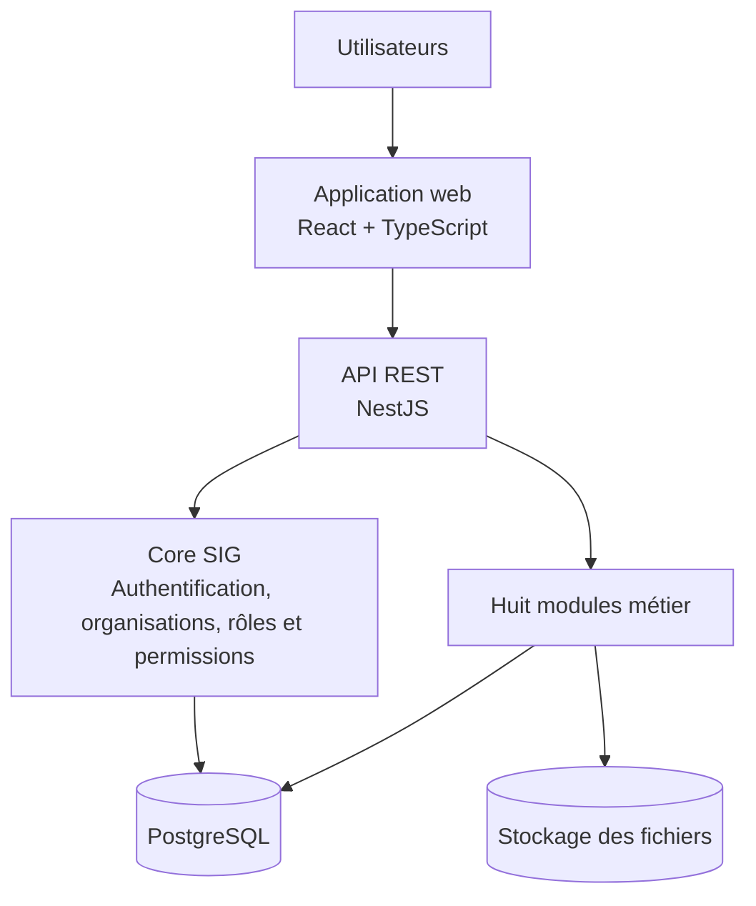

# SIG - Système d'Information de Gestion

> **Statut : conception de la V1 - développement à venir.**
> Ce dépôt présente actuellement les besoins, les spécifications fonctionnelles, l'architecture technique et une proposition de contrat API REST. Les fonctionnalités décrites ne sont pas encore présentées comme implémentées.

## Présentation

**SIG** est un projet d'application web de gestion destiné aux organisations souhaitant centraliser plusieurs activités au sein d'un même outil.

L'objectif est de proposer une plateforme **modulaire, multi-organisation et adaptée aux rôles des utilisateurs**. Chaque organisation pourra activer les modules qui répondent à ses besoins, gérer ses utilisateurs et définir leurs permissions, sans avoir à utiliser toutes les fonctionnalités du système.

La solution vise une interface ergonomique, personnalisable et responsive, accessible depuis un navigateur.

## Fonctionnalités prévues pour la V1

Le **Core SIG** centralisera les fonctions communes : authentification, organisations, comptes utilisateurs internes et externes, rôles, permissions, activation des modules et journalisation des actions sensibles.

Huit modules métier sont prévus :

| Module | Domaine | Fonctions principales envisagées |
|---|---|---|
| 1 | Événements et bénévoles | Événements, postes, affectations, participants et billetterie |
| 2 | Stocks et fournisseurs | Articles, mouvements de stock, seuils, alertes et fournisseurs |
| 3 | Ressources humaines | Dossiers des employés, contrats, congés et historique RH |
| 4 | Demandes internes | Tickets, attribution, suivi, commentaires et pièces jointes |
| 5 | Inventaires étendus | Équipements, mobilier, salles, localisations et affectations |
| 6 | Horaires et réservations | Calendriers, rendez-vous, disponibilités et salles |
| 7 | Clients et comptes externes | Profils externes, clients, bénévoles, fournisseurs et interactions |
| 8 | Gestion de projet | Tableaux Kanban, colonnes, cartes, tâches et assignations |

Les interactions entre modules seront disponibles uniquement lorsque les modules concernés sont activés et que l'utilisateur dispose des autorisations requises.

## Principes de conception

- **Modularité :** activation ou désactivation des modules selon les besoins de chaque organisation.
- **Multi-organisation :** séparation des utilisateurs, rôles, configurations et données de chaque organisation.
- **Contrôle des accès :** système RBAC (*Role-Based Access Control*) avec vérification des permissions côté backend.
- **Traçabilité :** journalisation des opérations sensibles et des changements de configuration.
- **Évolutivité :** architecture backend modulaire permettant d'ajouter des fonctionnalités progressivement.
- **Accessibilité web :** interface responsive pour ordinateur, tablette et téléphone.

## Architecture technique envisagée

| Couche | Technologies prévues |
|---|---|
| Frontend | React, TypeScript, Vite |
| Backend | Node.js, NestJS, TypeScript |
| API | REST, avec documentation OpenAPI/Swagger à générer |
| Base de données | PostgreSQL |
| Accès aux données | Prisma ORM |
| Sécurité | Sessions ou jetons sécurisés, RBAC et isolation des organisations |
| Fichiers | Stockage privé et références conservées en base |

L'architecture retenue pour la V1 est un **backend monolithique modulaire**, et non un ensemble de microservices.

> **Note :** ce diagramme présente l'architecture cible, pas un déploiement déjà opérationnel.

## Documentation

Les documents sont classés dans l'ordre de la démarche de conception :

| Document | Contenu |
|---|---|
| [Vision et feuille de route](docs/00-projet-sig.md) | Objectifs, proposition de valeur et étapes du projet |
| [Analyse des besoins](docs/01-analyse-des-besoins.md) | Acteurs, rôles, besoins et modules |
| [Conception et spécifications fonctionnelles](docs/02-conception-et-specifications-fonctionnelles.md) | Fonctionnalités, scénarios et diagrammes |
| [Conception technique](docs/03-conception-technique.md) | Architecture, données, sécurité et stratégie de développement |
| [Documentation API REST](docs/03-documentation-api-rest.md) | Conventions, routes proposées, permissions et exemples JSON |
Les diagrammes techniques sont rédigés en **Mermaid** pour être consultables directement sur GitHub.

**Attention :** les endpoints de la documentation API sont des **propositions de conception**. Leur implémentation devra être vérifiée dans le code et dans la spécification OpenAPI générée.

## Feuille de route

- [x] Analyse des besoins
- [x] Conception et spécifications fonctionnelles
- [x] Conception technique initiale
- [x] Proposition initiale du contrat API REST
- [ ] Validation des décisions techniques restantes
- [ ] Maquettes UX/UI et design system
- [ ] Mise en place du projet NestJS, React et de la base PostgreSQL
- [ ] Implémentation du Core SIG
- [ ] Développement progressif des huit modules métier
- [ ] Tests fonctionnels, d'intégration et de sécurité
- [ ] Documentation OpenAPI issue du backend et préparation d'une démonstration

Ces jalons représentent l'état de la documentation partagée ; ils pourront être ajustés au fil du développement.

## Installation et exécution

Les instructions d'installation et de lancement seront ajoutées **lorsque les projets frontend et backend auront été initialisés**. Aucun environnement exécutable n'est fourni dans la version documentaire présentée ici.

## Évolutions envisagées

De futurs modules pourront couvrir notamment la gestion financière, la communication interne et externe, la formation ainsi que les incidents, risques et conformité.

---

*Projet SIG - documentation de conception, V1.*
