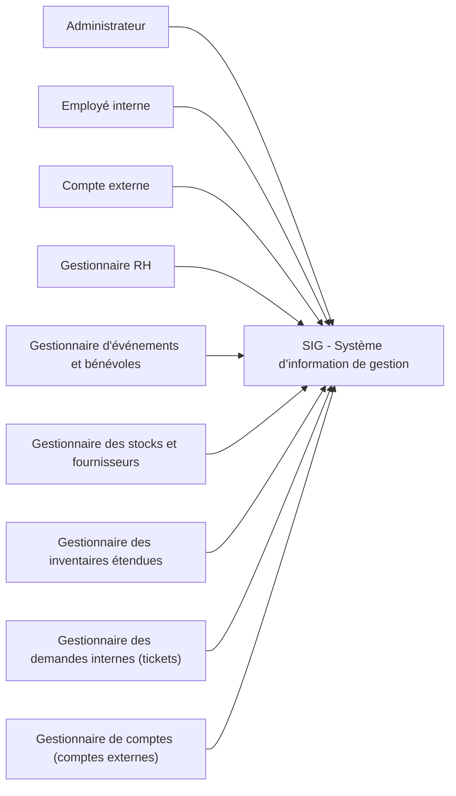

# Analyse des besoins

[← Accueil du projet](../README.md) · [Documentation](../README.md#documentation)

## Sommaire

- [1. Objectif de l’analyse des besoins](#1-objectif-de-lanalyse-des-besoins)
- [2. Identification des utilisateurs (rôles)](#2-identification-des-utilisateurs-rôles)
- [3. Modules du SIG](#3-modules-du-sig)
- [4. Besoins par module (v1 seulement)](#4-besoins-par-module-v1-seulement)
- [5. Annexe - Diagrammes UML](#5-annexe---diagrammes-uml)

---

&nbsp;
# 1. Objectif de l’analyse des besoins

L’objectif est de comprendre **qui utilise le SIG**, **pour quelles tâches**, **quelles problématiques réelles** il faut résoudre, et **quels modules doivent exister** dans la première version et les futures versions (v2, v3…).

&nbsp;
# 2. Identification des utilisateurs (rôles)

## Rôles de base (v0)

1.  **Administrateur** : Configure le SIG, gère les utilisateurs et employés internes, les rôles et les modules activés.
2.  **Employé interne** : Utilisateur standard de l’organisation (non RH, non gestionnaire spécialisé).
3.  **Compte externe** : Représente les clients de l’organisation (profil dans le système, mais pas un utilisateur “interne” du SIG).

## Rôles des modules prioritaires (pour une v1)

1.  **Gestionnaire RH** : Gère les employés (dossiers, congés, statuts, etc.).
2.  **Gestionnaire d’événements et bénévoles** : Planifie et gère les événements, les bénévoles **et la billetterie associée** (tickets vendus en ligne, listes de participants).
3.  **Gestionnaire des stocks et fournisseur** : Gère les stocks et les fournisseurs.
4.  **Gestionnaire des inventaires étendues** : Gère les inventaires de bureaux, mobilier, matériel
5.  **Gestionnaire des demandes internes (tickets)** : Supervise les tickets internes (assignation, suivi, résolution, etc.)
6.  **Gestionnaire de comptes** : Gère la base de données des comptes externes (profils, historique, segmentation simple).
7. **Compte externe** :
    1.  **Compte bénévole** : Intervient principalement dans le cadre d’événements, avec accès limité.
    2.  **Compte fournisseur**

## Rôles des modules non prioritaires (pour une v2)

1. Gestionnaire conformité / risques / audits
2. Gestionnaire de la comptabilité et des finances
3. Gestionnaire communication externe
4. Gestionnaire formations
5. Gestionnaire des partenaires
6. Compte externe :
    1.  Compte partenaire

&nbsp;
# 3. Modules du SIG

## Modules prioritaires (pour une v1) : 

1.  Module 1 - Gestion des événements et bénévoles
2.  Module 2 - Gestion des stocks et fournisseurs
3.  Module 3 - Gestion RH des employés internes
4.  Module 4 - Gestion des demandes internes (tickets)
5.  Module 5 - Gestion des inventaires étendus (bureaux)
6.  Module 6 - Gestion des horaires, prise de rendez-vous et réservation de salles
7.  Module 7 - Gestion des clients et comptes
8.  Module 8 - Gestion de projet (façon Trello)

## Modules non prioritaires (pour une v2) : 

1. Module 9 - Incidents, risques, audits, conformité
2. Module 10 - Gestion financière
3. Module 11 - Communication interne
4. Module 12 - Communication externe (newsletters)
5. Module 13 - Gestion des formations

&nbsp;
# 4. Besoins par module (v1 seulement)

## Module 0 - Gestion du SIG

### Objectif du module :
Assurer la gestion interne du système SIG lui-même. C’est le module “noyau” qui permet à l’organisation d’administrer son SIG.

### Acteurs :
- Administrateur
- Employé interne

### Fonctionnalités de base :
- Créer / modifier / désactiver des employés internes.
- Assigner ou retirer des rôles gestionnaires.
- Activer / désactiver des modules.
- Gérer les permissions globales.

## Module 1 - Gestion des événements et bénévoles 

### Objectif du module :
Permettre à l’organisation de gérer l’ensemble de son activité événementielle : création d’événements, gestion des bénévoles, organisation des postes, suivi des participants et billetterie associée.

### Acteurs :
- Gestionnaire d’événements
- Bénévoles

### Fonctionnalités de base :
- Créer / modifier / annuler un événement.
- Définir les informations d’un événement (titre, date, lieu, description, capacité, etc.).
- Créer des **postes** ou rôles pour l’événement (ex : accueil, logistique, sécurité).
- Associer des bénévoles à des événements et à des postes.
- Gérer les statuts des bénévoles : invité, confirmé, en attente, désisté.
- Gérer une billetterie :
  - définir types de billets (gratuit, payant, VIP, etc.),
  - définir le visuel des billets,
  - consulter le nombre de billets vendus,

### Fonctionnalités en plus car dépendances entre modules :
- Module 2 et/ou 5 : Associer un événement à des ressources (salles, matériel, etc. si les modules sont activés).
- Module 4 : Créer des tickets internes liés à un événement (problème de matériel, besoin supplémentaire, incident, etc.).
- Module 6 : Créer des quarts de travail, associer un quart de travail à un événement et associés un bénévole à un ou plusieurs quarts de travail
- Module 7 : Gérer les comptes externes bénévoles

## Module 2 - Gestion des stocks et fournisseurs

### Objectif du module :
Gérer les ressources matérielles de l’organisation (consommables, matériel technique, etc.) ainsi que les fournisseurs associés.

### Acteurs :
- Gestionnaire des stocks et fournisseurs

### Fonctionnalités de base :
- Créer / modifier / supprimer des articles (nom, catégorie, quantité, unité, localisation…).
- Enregistrer des mouvements de stock (entrée, sortie, ajustement).
- Gérer les seuils minimums et alertes de réapprovisionnement.
- Gérer la liste des fournisseurs (coordonnées, type de produits, statut).
- Associer des articles à un ou plusieurs fournisseurs.
- Consulter l’historique des mouvements de stock.

### Fonctionnalités en plus car dépendances entre modules :
- Module 7 : Gérer les comptes externes fournisseurs

## Module 3 - Gestion RH des employés internes

### Objectif du module :
Gérer les informations RH des **employés internes** : dossiers, statuts, contrats, congés, absences, etc.

### Acteurs :
- Gestionnaire RH

### Fonctionnalités de base :
- Créer / modifier / désactiver des fiches employés (données personnelles, poste, département, statut).
- Définir la hiérarchie interne (qui supervise qui)
- Gérer les contrats (dates, type, document associé).
- Gérer les statuts : actif, en congé, en probation, etc.
- Gérer les demandes de congés et absences (validation, refus, historique).
- Consulter l’historique RH d’un employé (changements de poste, incidents, notes internes).

### Fonctionnalités en plus car dépendances entre modules :
- Module 4 : Créer des tickets RH spécifiques (ex : conflit, problème de paie).

## Module 4 - Gestion des demandes internes (tickets) 

### Objectif du module :
Centraliser toutes les demandes internes (problèmes, questions, demandes de support) via un système de tickets.

### Acteurs :
- Gestionnaire des demandes internes (tickets)

### Fonctionnalités de base :
- Permettre à tout utilisateur (employé interne ou compte externe) de créer un ticket.
- Définir un type de ticket (RH, IT, logistique, événement, client, etc.).
- Assigner un ticket à un responsable ou une équipe (ex : RH, stock, événement).
- Mettre à jour le statut d’un ticket : ouvert, en cours, en attente, résolu, fermé.
- Ajouter des commentaires, pièces jointes, historiques d’actions.
- Filtrer et rechercher des tickets par type, statut, responsable, priorité.

## Module 5 - Gestion des inventaires étendus (bureaux) 

### Objectif du module :
Gérer l’inventaire des ressources non “stockables” classiques : bureaux, mobilier, équipements de bureau, etc.

### Acteurs :
- Gestionnaire des inventaires étendus

### Fonctionnalités de base :
- Créer des fiches d’actifs (équipements de bureau, bureau, ordinateur, salles, etc.)
- Associer chaque actif à une localisation (étage, bureau, bâtiment).
- Associer un état (en service, en réparation, hors service, à remplacer).
- Suivre la “vie” d’un actif (date d’achat, valeur, maintenance, affectation).
- Gérer une liste de catégories (IT, mobilier, salle, véhicule, etc.).

## Module 6 - Gestion des horaires, prise de rendez-vous et réservation de salles

### Objectif du module :
Permettre à chaque utilisateur interne de gérer son horaire et d’organiser des rendez-vous internes ou des réservations de salles dans un seul calendrier.

### Acteurs :
- Aucun rôle gestionnaire dédié (module transversal).

### Fonctionnalités de base :
- Gérer son propre calendrier (créneaux, disponibilités, absences).
- Visualiser l’horaire des personnes supervisées (selon hiérarchie).
- Vues : jour / semaine / mois.
- Inviter des participants internes à un rendez-vous.
- Modifier ou annuler une réservation.
- Ajouter un objet, description ou pièce jointe au rendez-vous.

### Fonctionnalités en plus car dépendances entre modules :
- Module 5 : Réserver une salle ou un espace interne.
- Module 5 : Visualiser la disponibilité des salles.

## Module 7 - Gestion des clients et comptes 

### Objectif du module
Gérer tous les **comptes externes** de type “client” (et plus tard autres types), avec historique de relation.

### Acteurs
- Gestionnaire des clients

### Fonctionnalités de base
- Créer / modifier des comptes clients.
- Gérer les informations de base : coordonnées, type de client, notes internes.
- Visualiser l’historique des interactions (ex : participation à des événements, achats de billets, tickets).
- Segmenter les clients (tags, catégories, niveaux de priorité).

## Module 8 - Gestion de projet

### Objectif du module
Offrir à chaque employé interne un espace pour organiser ses tâches et projets, individuellement ou en équipe, façon Trello/Asana.

### Acteurs
- Aucun rôle gestionnaire dédié (module transversal).

### Fonctionnalités de base
- Créer des tableaux de projet.
- Créer des listes
- Créer des cartes et les déplacer entre listes.
- Assigner des tâches à des personnes.
- Ajouter des commentaires, pièces jointes, échéances.
- Créer des tableaux personnels et des tableaux d’équipe.

&nbsp;
# 5. Annexe - Diagrammes UML

## Annexe 1 - Diagramme de contexte : 

## Annexe 2 - Diagramme de cas d'utilisation global : 

```mermaid
flowchart LR
    %% Adaptation du diagramme de cas d’utilisation PlantUML pour GitHub
    Admin["Administrateur"]
    Emp["Employé interne"]
    CExterne["Compte externe"]
    GRH["Gestionnaire RH"]
    GEvent["Gestionnaire d'événements <br/> et bénévoles"]
    GStock["Gestionnaire des <br/> stocks et fournisseurs"]
    GInv["Gestionnaire des <br/> inventaires étendues"]
    GTicket["Gestionnaire des <br/> demandes internes (tickets)"]
    GComptes["Gestionnaire de comptes <br/> (comptes externes)"]
    subgraph M0["Module 0 - Gestion du SIG"]
        UC_M0_1(["Créer / modifier / désactiver <br/> des employés internes"])
        UC_M0_2(["Assigner ou retirer des <br/> rôles gestionnaires"])
        UC_M0_3(["Activer / désactiver des modules"])
        UC_M0_4(["Gérer les permissions globales"])
    end
    subgraph M1["Module 1 - Gestion des <br/> événements et bénévoles"]
        UC_M1_1(["Créer / modifier / annuler un événement"])
        UC_M1_2(["Définir les informations d’un événement"])
        UC_M1_3(["Créer et gérer les bénévoles"])
        UC_M1_4(["Créer et gérer des postes pour l’événement"])
        UC_M1_5(["Assigner des bénévoles <br/> à des postes d'événement"])
        UC_M1_6(["Créer et gérer la billetterie"])
    end
    subgraph M2["Module 2 - Gestion des stocks<br/>et fournisseurs"]
        UC_M2_1(["Créer / modifier / supprimer des articles"])
        UC_M2_2(["Enregistrer des mouvements de stock"])
        UC_M2_3(["Gérer les seuils minimums et <br/> alertes de réapprovisionnement"])
        UC_M2_4(["Gérer les fournisseurs"])
        UC_M2_5(["Associer des articles à <br/> un ou plusieurs fournisseurs"])
        UC_M2_6(["Consulter l’historique <br/> des mouvements de stock"])
        UC_M2_extra(["Associer un événement à des ressources"])
    end
    subgraph M3["Module 3 - Gestion RH"]
        UC_M3_1(["Créer / modifier / désactiver <br/> des fiches employés"])
        UC_M3_2(["Définir la hiérarchie interne <br/> (qui supervise qui)"])
        UC_M3_3(["Gérer les contrats"])
        UC_M3_4(["Gérer les statuts"])
        UC_M3_5(["Gérer les demandes de <br/> congés et absences"])
        UC_M3_6(["Consulter l'historique <br/> RH d'un employé"])
    end
    subgraph M4["Module 4 - Gestion des demandes<br/>internes (tickets)"]
        UC_M4_1(["Créer un ticket"])
        UC_M4_2(["Assigner un ticket"])
        UC_M4_3(["Mettre à jour le statut d'un ticket"])
        UC_M4_4(["Commenter un ticket"])
        UC_M4_5(["Filtrer et rechercher des tickets"])
        UC_M4_extra1(["Créer des tickets liés à un événement"])
        UC_M4_extra2(["Créer des tickets RH spécifiques"])
    end
    subgraph M5["Module 5 - Gestion des <br/> inventaires étendus (bureaux)"]
        UC_M5_1(["Créer des fiches d’actifs <br/> (équipements de bureau, bureau, <br/> ordinateur, salle de réunion)"])
        UC_M5_2(["Gérer la localisation des actifs"])
        UC_M5_3(["Gérer l'état des actifs"])
        UC_M5_4(["Suivre l'historique des actifs"])
        UC_M5_extra1(["Associer un événement à <br/> des ressources et lieux"])
        UC_M5_extra2(["Réserver une salle ou un <br/> espace pour un rendez-vous"])
        UC_M5_extra3(["Visualiser la disponibilité des <br/> salles pour un rendez-vous"])
    end
    subgraph M6["Module 6 - Gestion des horaires, <br/> RDV et réservations de salles"]
        UC_M6_1(["Gérer son propre calendrier"])
        UC_M6_2(["Voir et consulter l'horaire <br/> des personnes supervisées"])
        UC_M6_3(["Créer / modifier / annuler un rendez-vous"])
        UC_M6_4(["Inviter des participants <br/> internes à un rendez-vous"])
        UC_M6_extra(["Créer et gérer des quarts de travail"])
    end
    subgraph M7["Module 7 - Gestion des clients<br/>et comptes externes"]
        UC_M7_1(["Créer / modifier des comptes clients"])
        UC_M7_2(["Consulter l'historique d'un compte"])
        UC_M7_3(["Segmenter les clients"])
        UC_M7_extra1(["Gérer les comptes bénévoles"])
        UC_M7_extra2(["Gérer les comptes fournisseurs"])
    end
    subgraph M8["Module 8 - Gestion de projet"]
        UC_M8_1(["Créer un tableau de projet"])
        UC_M8_2(["Créer des listes"])
        UC_M8_3(["Créer et gérer des cartes (tâches)"])
        UC_M8_4(["Assigner une tâche à des membres"])
        UC_M8_5(["Créer des tableaux personnels <br/> et des tableaux d’équipe."])
    end
    Admin --> UC_M0_1
    Admin --> UC_M0_2
    Admin --> UC_M0_3
    Admin --> UC_M0_4
    GEvent --> UC_M1_1
    GEvent --> UC_M1_2
    GEvent --> UC_M1_3
    GEvent --> UC_M1_4
    GEvent --> UC_M1_5
    GEvent --> UC_M1_6
    GStock --> UC_M2_1
    GStock --> UC_M2_2
    GStock --> UC_M2_3
    GStock --> UC_M2_4
    GStock --> UC_M2_5
    GStock --> UC_M2_6
    GEvent --> UC_M2_extra
    GRH --> UC_M3_1
    GRH --> UC_M3_2
    GRH --> UC_M3_3
    GRH --> UC_M3_4
    GRH --> UC_M3_5
    GRH --> UC_M3_6
    Emp --> UC_M4_1
    CExterne --> UC_M4_1
    GTicket --> UC_M4_2
    GTicket --> UC_M4_3
    GTicket --> UC_M4_4
    GTicket --> UC_M4_5
    GEvent --> UC_M4_extra1
    GRH --> UC_M4_extra2
    GInv --> UC_M5_1
    GInv --> UC_M5_2
    GInv --> UC_M5_3
    GInv --> UC_M5_4
    GEvent --> UC_M5_extra1
    Emp --> UC_M5_extra2
    Emp --> UC_M5_extra3
    Emp --> UC_M6_1
    Emp --> UC_M6_2
    Emp --> UC_M6_3
    Emp --> UC_M6_4
    GEvent --> UC_M6_extra
    GComptes --> UC_M7_1
    GComptes --> UC_M7_2
    GComptes --> UC_M7_3
    CExterne --> UC_M7_1
    CExterne --> UC_M7_2
    GEvent --> UC_M7_extra1
    GStock --> UC_M7_extra2
    Emp --> UC_M8_1
    Emp --> UC_M8_2
    Emp --> UC_M8_3
    Emp --> UC_M8_4
    Emp --> UC_M8_5
```

