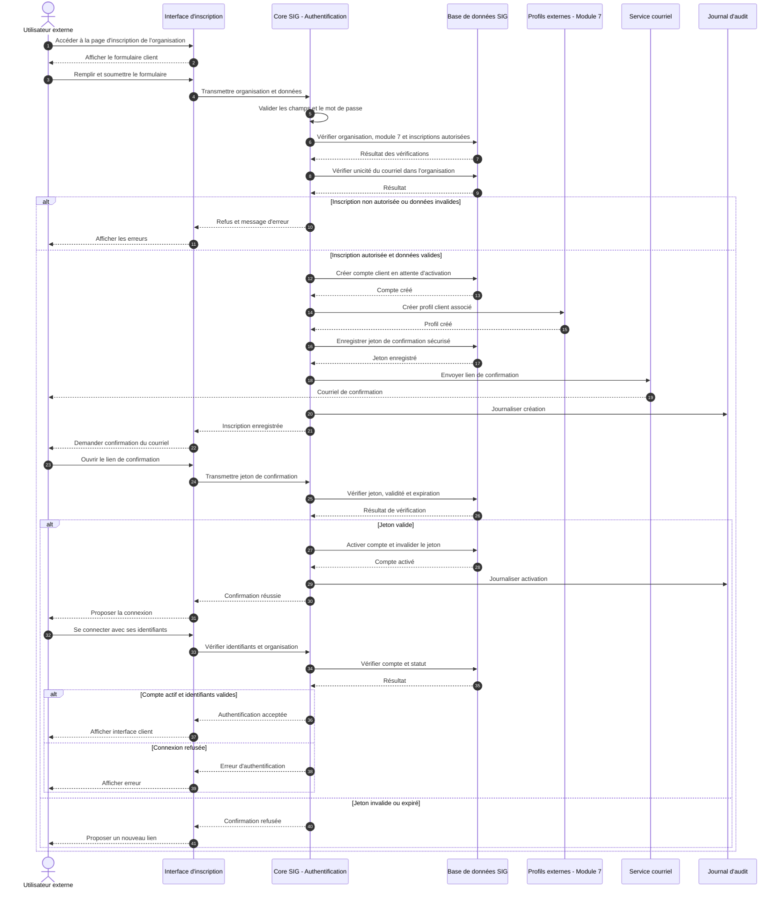
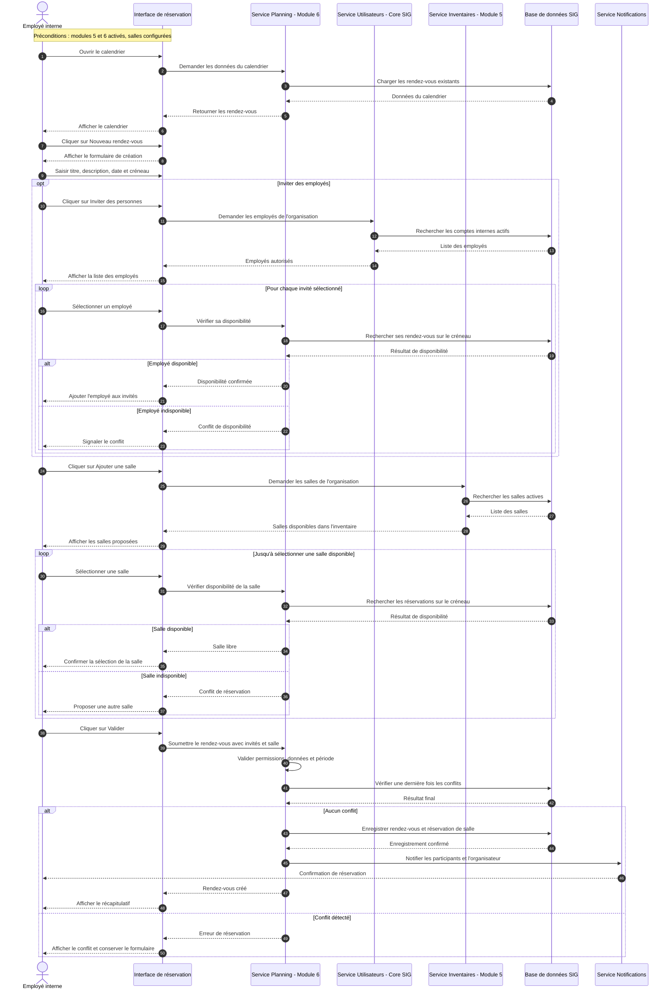
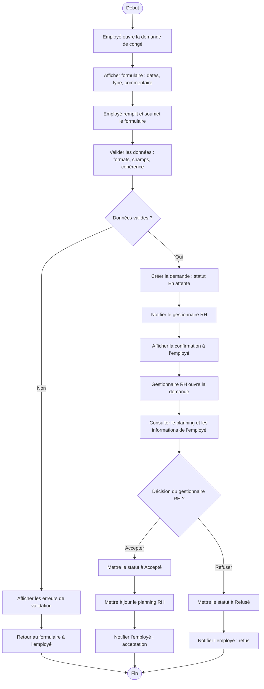

# Conception et spécifications fonctionnelles

[← Accueil du projet](../README.md) · [Documentation](../README.md#documentation)

## Sommaire

1.  [**Objectif de la conception et spécifications fonctionnelles**](#objectif-de-la-conception-et-spécifications-fonctionnelles)
2.  [**Spécifications fonctionnelles**](#spécifications-fonctionnelles)
    1.  [Spécifications générale](#spécifications-générale)
    2.  [Administrateur](#administrateur)
    3.  [Employé interne](#employé-interne)
    4.  [Employé interne de type “superviseur”](#employé-interne-de-type-superviseur)
    5.  [Compte externe](#compte-externe)
    6.  [Gestionnaire RH](#gestionnaire-rh)
    7.  [Gestionnaire d’événements et bénévoles](#gestionnaire-dévénements-et-bénévoles)
    8.  [Gestionnaire des stocks et fournisseurs](#gestionnaire-des-stocks-et-fournisseurs)
    9.  [Gestionnaire des inventaires étendus](#gestionnaire-des-inventaires-étendus)
    10. [Gestionnaire des demandes internes (tickets)](#gestionnaire-des-demandes-internes-tickets)
    11. [Gestionnaire de comptes externes](#gestionnaire-de-comptes-externes)
    12. [Comptes externes de type “bénévoles”](#comptes-externes-de-type-bénévoles)
    13. [Comptes externes de type “fournisseurs”](#comptes-externes-de-type-fournisseurs)
3.  [**Scénarios**](#scénarios)
    1.  [Scénario A - Création d’un compte employé interne par l’administrateur](#scénario-a---création-dun-compte-employé-interne-par-ladministrateur)
    2.  [Scénario B - Création d’un compte client par l’utilisateur lui-même](#scénario-b---création-dun-compte-client-par-lutilisateur-lui-même)
    3.  [Scénario M1 - Planification d’un événement avec besoins en bénévoles](#scénario-m1-module-1---planification-dun-événement-avec-besoins-en-bénévoles)
    4.  [Scénario M2 - Sortie de stock pour un événement](#scénario-m2---sortie-de-stock-pour-un-événement)
    5.  [Scénario M3 - Validation d’une demande de congé](#scénario-m3---validation-dune-demande-de-congé)
    6.  [Scénario M4 - Création et assignation d’un ticket interne](#scénario-m4---création-et-assignation-dun-ticket-interne)
    7.  [Scénario M5 - Attribution d’un équipement à un employé](#scénario-m5---attribution-dun-équipement-à-un-employé)
    8.  [Scénario M6 - Réservation d’une salle de réunion](#scénario-m6---réservation-dune-salle-de-réunion)
    9.  [Scénario M7 - Création d’un compte client par le Gestionnaire de comptes externes](#scénario-m7---création-dun-compte-client-par-le-gestionnaire-de-comptes-externes)
    10. [Scénario M8 - Création et suivi d’une tâche dans un tableau](#scénario-m8---création-et-suivi-dune-tâche-dans-un-tableau)
4.  [**Annexes - Diagrammes UML (code PlantUML)**](#annexe---diagrammes-uml)
    1.  [Annexe 1 - Diagrammes de séquence du scénario B](#annexe-1---diagrammes-de-séquence-du-scénario-b)
    2.  [Annexe 2 - Diagrammes de séquence du scénario M6](#annexe-2---diagrammes-de-séquence-du-scénario-m6)
    3.  [Annexe 3 - Diagramme d'activité pour une demande de congé](#annexe-3---diagramme-dactivité-pour-une-demande-de-congé)

&nbsp;
# 1. Objectif de la conception et spécifications fonctionnelles

L’objectif de cette étape est de transformer les besoins exprimés dans l’analyse en **fonctionnalités concrètes**, organisées sous forme de **user stories**, de **règles**, et de **scénarios d’utilisation**. Ces spécifications serviront ensuite de base pour la conception technique, l’architecture, le design UX/UI et le développement.

&nbsp;
# 2. Spécifications fonctionnelles

## Spécifications générale

### Authentification & Permissions :
- Le système doit vérifier les identifiants à chaque connexion.
- Le système doit appliquer des permissions basées sur les rôles.
- Le système doit rediriger l’utilisateur vers son tableau de bord spécifique.
- Le système doit masquer les modules non activés.

### Gestion des profils utilisateurs :
- Le système doit valider chaque champ selon un modèle (format courriel, téléphone, etc.).
- Le système doit empêcher la désactivation d’un utilisateur assigné à une tâche active autre que celles du module 8.
- Le système ne doit proposer que la désactivation et l’archivage d’un compte employé ou compte externe (un compte ne doit jamais être supprimable).
- Le système doit permettre la réactivation d’un compte désactivé.
- Le système doit permettre le désarchivage d’un compte archivé.

### Gestion des données :
- Le système doit sauvegarder toutes les données.
- Le système doit empêcher les doublons selon les contraintes de chaque ressource. Pour les comptes utilisateurs, un courriel doit être unique au sein d'une même organisation.

### Recherche et filtres :
- Le système doit permettre la recherche multi-critères (nom, statut, catégorie…).
- Le système doit afficher les résultats sous forme de tableau filtrable.

## Administrateur

### Front-office *(= interface utilisateur)* :
- L’Administrateur doit pouvoir accéder à un tableau de bord centralisé.
- L’Administrateur doit pouvoir gérer les employés internes et comptes externes.
- L’Administrateur doit pouvoir configurer les modules (les activés et désactivés)
- L’Administrateur doit pouvoir gérer les rôles et permissions (les activés et désactivés) de chaques employés internes et comptes externes.
- L’Administrateur doit pouvoir gérer les paramètres globaux (logo, thèmes, langues).

### Back-office *(= fonctionnement interne et logique métier)* :
- Le système doit historiser toutes les actions sensibles.
- Le système doit gérer la configuration dynamique des modules.

## Employé interne

### Front-office :
- L’employé interne doit pouvoir consulter ses informations personnelles.
- Si module 8 activé : L’employé interne doit pouvoir consulter son tableau de bord et ses projets personnels ou de groupe.
- Si module 4 activé : L’employé interne doit pouvoir consulter ou soumettre des demandes internes (tickets).
- Si module 6 activé : L’employé interne doit pouvoir consulter son horaire.
- Si module 6 activé : L’employé interne doit pouvoir partager son calendrier avec d'autres employés internes.
- Si modules 5 et 6 activés : L’employé interne doit pouvoir réserver une salle ou un créneau.

### Back-office :
- Le système doit appliquer les permissions de rôle si un employé interne devient le gestionnaire d’un ou de plusieurs module

## Employé interne de type “superviseur”

### Front-office :
- Si module 6 activé : L’employé interne doit pouvoir consulter l’horaire des employés qu’il supervise.

## Compte externe

### Front-office :
- Le client doit pouvoir créer un compte.
- Le client doit pouvoir consulter son profil et son historique d’activité (ses derniers achats, ses dernières factures, etc.).
- Le client doit pouvoir modifier son profil.
- Si module 4 activé : Le client doit pouvoir créer un ticket lié à son besoin.

### Back-office :
- Le système doit restreindre les informations visibles selon le type du compte externe.

## Gestionnaire RH

### Front-office :
- Le Gestionnaire RH doit pouvoir gérer les dossiers employés.
- Le Gestionnaire RH doit pouvoir approuver/refuser des demandes de congé.
- Le Gestionnaire RH doit pouvoir gérer les contrats et statuts.

### Back-office :
- Le système doit appliquer des workflows RH (validation obligatoire).

## Gestionnaire d’événements et bénévoles

### Front-office :
- Le Gestionnaire doit pouvoir créer et modifier un événement.
- Le Gestionnaire doit pouvoir définir les postes et besoins.
- Le Gestionnaire doit pouvoir assigner des bénévoles à un événement
- Si module 5 activé : Le Gestionnaire doit pouvoir assigner un lieu ou une salle à un événement
- Si module 6 activé : Le Gestionnaire doit pouvoir assigner des quart de travail à un événement
- Si module 6 activé : Le Gestionnaire doit pouvoir assigner un bénévoles à un des quart de travail
- Si module 6 activé : Le Gestionnaire doit pouvoir visualiser les présences et retard.

### Back-office :
- Le système doit synchroniser événement ↔ ressources ↔ bénévoles.
- Le système doit mettre à jour les statuts de participation.

## Gestionnaire des stocks et fournisseurs

### Front-office :
- Le gestionnaire doit pouvoir ajouter des articles de stock.
- Le gestionnaire doit pouvoir enregistrer des entrées/sorties.
- Le gestionnaire doit pouvoir gérer les comptes externes de type “fournisseurs”.

### Back-office :
- Le système doit générer des alertes de seuil.
- Le système doit maintenir un historique des mouvements.

## Gestionnaire des inventaires étendus

### Front-office :
- Le gestionnaire doit pouvoir enregistrer des actifs (bureaux, matériel, salle, etc.).
- Le gestionnaire doit pouvoir modifier leur état ou localisation.
- Le gestionnaire doit pouvoir attribuer des équipements à des employés.

### Back-office :
- Le système doit enregistrer l’historique de vie d'un actif.

## Gestionnaire des demandes internes (tickets)

### Front-office :
- Le gestionnaire doit pouvoir consulter tous les tickets.
- Le gestionnaire doit pouvoir assigner un ticket à un employé.
- Le gestionnaire doit pouvoir changer le statut d’un ticket.

### Back-office :
- Le système doit automatiser les transitions de statut.
- Le système doit sauvegarder l’historique des tickets et leurs pièces jointes.

## Gestionnaire de comptes externes

### Front-office :
- Le gestionnaire doit pouvoir créer, modifier, désactiver un compte externe.
- Le gestionnaire doit pouvoir consulter l’historique d’activité d’un compte externe.

## Comptes externes de type “bénévoles”

### Front-office :
- Le bénévole doit pouvoir donner ses choix de bénévolat.
- Le bénévole doit pouvoir accepter/refuser une affectation.
- Le bénévole doit pouvoir voir le statut de sa demande de bénévolat.

## Comptes externes de type “fournisseurs”

### Front-office :
- Le fournisseur doit pouvoir voir les articles qu’il fournit (si module 2 activé)
- Le fournisseur doit pouvoir téléverser des documents pertinents (facture, devis, fiche technique)
- Le fournisseur doit pouvoir voir le statut de ce qu’il fournit

&nbsp;
# 3. Scénarios

## Scénario A - Création d’un compte employé interne par l’administrateur

### Acteurs :
- Administrateur

### Préconditions :
- L’Administrateur est connecté.

### Déclencheur :
L’Administrateur clique sur "Créer un employé interne".

### Étapes :
1.  L’Administrateur ouvre la section "Gestion des employés internes".
2.  Le système affiche la liste des employés et un bouton "Nouveau compte".
3.  L’Administrateur clique sur "Nouveau compte".
4.  Le système affiche un formulaire (nom, prénom, courriel, rôle, position hiérarchique, etc.).
5.  L’Administrateur remplit les champs requis et sélectionne un rôle interne selon les modules activés ainsi que sa position hiérarchique au sein de l’entreprise.
6.  Le système valide les données (format de courriel, unicité du courriel, champs obligatoires).
7.  Si tout est valide, le système crée le compte au statut *Actif*.
8.  Le système génère un moyen d’accès (mot de passe temporaire ou lien d’activation).
9.  Le système enregistre l’action dans l’historique (log Admin).

### Postconditions :
- Un nouveau compte employé interne existe, actif, avec un rôle défini et une position hiérarchique.
- L’employé pourra se connecter et voir son interface selon son rôle.

### Exceptions :
- Courriel déjà existant → le système affiche une erreur et refuse la création.
- Champs obligatoires manquants → message de validation, le compte n’est pas créé.
- Format et type des données → le système affiche une erreur et refuse la création.

## Scénario B - Création d’un compte client par l’utilisateur lui-même

### Acteurs :
- Utilisateur externe souhaitant créer un compte client.

### Préconditions :
- L'organisation concernée est identifiée à partir d'un lien d'inscription propre à cette organisation.
- Le module 7 est activé pour cette organisation.
- L'organisation autorise l'inscription publique des clients.

### Déclencheur :
L’utilisateur externe souhaite créer un compte client pour accéder aux services d’une organisation utilisant le SIG.

### Étapes :
1. L’utilisateur externe accède à la page d’inscription de l’organisation.
2. Le système affiche un formulaire d’inscription avec les champs requis : nom, prénom, courriel, mot de passe et confirmation du mot de passe.
3. L’utilisateur remplit les informations obligatoires.
4. Le système vérifie que l’organisation autorise les inscriptions et valide les données saisies (formats, champs obligatoires, conformité du mot de passe et unicité du courriel dans l’organisation).
5. Si les données sont valides, le Core SIG crée un compte externe de type « Client », associé à l’organisation et au statut « En attente d’activation ».
6. Si le module 7 est activé, le système crée le profil client associé au compte.
7. Le système envoie un courriel contenant un lien sécurisé de confirmation.
8. L’utilisateur confirme son adresse courriel en utilisant le lien reçu.
9. Le système valide le lien, active le compte et enregistre l’opération dans l’historique.
10. L’utilisateur peut se connecter et accéder à son interface client.

### Postconditions :
- Un compte client actif est associé à l’organisation concernée.
- Le courriel du client est confirmé.
- Le compte possède les permissions par défaut d’un client.
- Le profil client est disponible dans le module 7.
- L’utilisateur peut se connecter et accéder uniquement aux fonctionnalités autorisées.

### Exceptions :
- Organisation inexistante ou inscriptions publiques désactivées → le système refuse l’inscription.
- Module 7 désactivé → l'inscription publique des clients n'est pas disponible.
- Courriel déjà utilisé dans l’organisation → le système refuse la création et affiche un message d’erreur.
- Champs invalides ou mot de passe non conforme → le système affiche les erreurs correspondantes.
- Lien de confirmation expiré ou invalide → le compte reste en attente d’activation et l’utilisateur doit demander un nouveau lien.

## Scénario M1 (= module 1) - Planification d’un événement avec besoins en bénévoles

### Acteurs :
- Gestionnaire d’événements

### Préconditions :
- Le module 1 est activé.
- Le Gestionnaire est connecté.

### Déclencheur :
Le Gestionnaire souhaite planifier un nouvel événement.

### Étapes :
1.  Le Gestionnaire ouvre le module "Événements".
2.  Le système affiche la liste des événements existants et un bouton "Nouvel événement".
3.  Le Gestionnaire clique sur "Nouvel événement".
4.  Le système affiche un formulaire (nom, date, lieu, description).
5.  Le Gestionnaire saisit les informations générales de l’événement.
6.  Le Gestionnaire renseigne les besoins en bénévoles : nombre de postes, types de tâches, compétences nécessaires.
7.  Le système valide les données et enregistre l’événement au statut *Brouillon* ou *Planifié*.
8.  Le système rend l’événement disponible pour l’assignation de bénévoles ou l’ouverture d’inscriptions.

### Postconditions :
- Un événement est créé, avec ses besoins en bénévoles définis.

## Scénario M2 - Sortie de stock pour un événement

### Acteurs **:**
- Gestionnaire des stocks

### Préconditions :
- Le module 2 est activé.
- Les articles de stock sont déjà enregistrés.

### Déclencheur :
Le Gestionnaire des stocks doit sortir du matériel pour un événement.

### Étapes :
1.  Le Gestionnaire ouvre le module "Stocks".
2.  Le système affiche la liste des articles de stock.
3.  Le Gestionnaire sélectionne un article.
4.  Il clique sur "Mouvement de stock" puis choisit "Sortie".
5.  Il indique la quantité et le motif (par exemple : "Événement X").
6.  Le système vérifie que la quantité demandée est disponible.
7.  Si la quantité est suffisante, le système met à jour la quantité en stock.
8.  Le système enregistre le mouvement dans l’historique (date, quantité, motif).
9.  Si la quantité restante passe sous le seuil, le système génère une alerte de stock faible.

### Postconditions :
- Le stock est décrémenté et le mouvement tracé.

### Exceptions :
- Stock insuffisant → la sortie est refusée, message d’erreur affiché.

## Scénario M3 - Validation d’une demande de congé

### Acteurs :
- Employé interne
- Gestionnaire RH

### Préconditions :
- Le module 3 est activé.
- L’employé possède un compte actif.

### Déclencheur :
L’employé souhaite demander un congé.

### Étapes :
1.  L’employé ouvre la section "Demande de congé".
2.  Le système affiche un formulaire (dates, type de congé, commentaire).
3.  L’employé remplit et soumet le formulaire.
4.  Le système valide les données et crée la demande au statut "*En attente*".
5.  Le Gestionnaire RH reçoit une notification.
6.  Le Gestionnaire RH ouvre la demande, consulte le planning et les informations liées.
7.  Le Gestionnaire RH accepte ou refuse la demande.
8.  Le système met à jour le statut (Accepté / Refusé) et notifie l’employé.

### Postconditions :
- Le planning RH est mis à jour si le congé est accepté.

## Scénario M4 - Création et assignation d’un ticket interne

### Acteurs :
- Employé interne
- Gestionnaire des tickets

### Préconditions :
- Le module 4 est activé.

### Déclencheur :
- Un employé constate un problème ou a une demande interne.

### Étapes :
1.  L’employé ouvre le module "Tickets internes".
2.  Il clique sur "Nouveau ticket".
3.  Le système affiche un formulaire (catégorie, description, priorité, pièce jointe éventuelle).
4.  L’employé remplit les informations et soumet le ticket.
5.  Le système valide les champs et crée le ticket au statut "*Ouvert*".
6.  Le Gestionnaire des tickets reçoit une notification.
7.  Le Gestionnaire ouvre le ticket et l’assigne à un employé responsable.
8.  Le système met à jour le statut à *Assigné*.

### Postconditions :
- Le ticket existe avec un responsable identifié.

## Scénario M5 - Attribution d’un équipement à un employé

### Acteurs :
- Gestionnaire des inventaires étendus

### Préconditions :
- Le module 5 est activé.
- L’équipement est enregistré dans le système.

### Déclencheur :
Le Gestionnaire doit attribuer un équipement (ex. laptop, chaise, bureau) à un employé.

### Étapes :
1.  Le Gestionnaire ouvre le module "Inventaires étendus".
2.  Le système affiche la liste des équipements.
3.  Le Gestionnaire sélectionne un équipement.
4.  Le système affiche les détails (état, localisation, historique).
5.  Le Gestionnaire clique sur "Attribuer à un employé".
6.  Le système propose une liste d’employés internes.
7.  Le Gestionnaire sélectionne un employé et valide.
8.  Le système met à jour la fiche de l’équipement (nouveau détenteur, localisation).
9.  Le système ajoute une entrée dans l’historique de vie de l’actif.

### Postconditions :
- L’équipement est lié à l’employé choisi.

## Scénario M6 - Réservation d’une salle de réunion

### Acteurs :
- Employé interne

### Préconditions :
- Les modules 5 et 6 sont activés.
- Des salles sont configurées dans le système.

### Déclencheur :
L’employé doit réserver une salle pour une réunion.

### Étapes :
1.  L’employé ouvre le module "Réservation de salles".
2.  Le système affiche un calendrier avec la liste des salles.
3.  L’employé choisit une date et un créneau horaire.
4.  Le système affiche les salles disponibles sur ce créneau.
5.  L’employé sélectionne une salle et confirme la réservation.
6.  Le système vérifie qu’il n’y a pas de conflit.
7.  Le système enregistre la réservation et l’associe à l’employé (et éventuellement à un événement ou projet).
8.  Le système envoie les notifications nécessaires (participants, gestionnaire, etc.).

### Postconditions :
- La salle est réservée sur le créneau choisi.

## Scénario M7 - Création d’un compte client par le Gestionnaire de comptes externes

### Acteurs :
- Gestionnaire de comptes externes

### Préconditions :
- Le Gestionnaire de comptes est connecté.
- Le module 7 est actif.

### Déclencheur :
Le Gestionnaire de comptes souhaite créer un nouveau compte externe.

### Étapes :
1.  Le Gestionnaire ouvre la section "Comptes externes".
2. Le système affiche la liste des comptes externes existants.
3. Le Gestionnaire clique sur "Nouveau compte externe".
4. Le système affiche un formulaire avec : type de compte selon les modules activés (client / bénévole / fournisseur), nom, courriel, organisation, téléphone, etc.
5. Le Gestionnaire sélectionne un type de compte et remplit les informations.
6. Le système valide les champs et vérifie l’unicité du courriel.
7. Si tout est valide, le système crée le compte au statut *Actif*.
8. Le système associe des permissions par défaut selon le type (client, bénévole, fournisseur).
9. Le système enregistre la création dans l’historique.

### Postconditions :
- Un compte externe est créé, actif, de type défini, prêt à se connecter.

### Exceptions :
- Courriel déjà utilisé → le système refuse la création et notifie le gestionnaire.

## Scénario M8 - Création et suivi d’une tâche dans un tableau

### Acteurs :
- Employé interne

### Préconditions :
- Le module 8 est activé.

### Déclencheur :
L’employé veut organiser son travail ou celui de son équipe sous forme de tableau.

### Étapes :
1.  L’employé ouvre le module "Projets".
2.  Le système affiche la liste des tableaux existants.
3.  L’employé crée un nouveau tableau de projet ou ouvre un tableau existant.
4.  L’employé ajoute des colonnes (ex. À faire, En cours, Terminé) si nécessaire.
5.  L’employé crée une nouvelle carte de tâche (titre, description, échéance, assigné).
6.  Le système enregistre la tâche dans la colonne "À faire".
7.  Au fil de l’avancement, l’employé (ou un autre membre) déplace la carte dans la colonne appropriée.
8.  Le système met à jour l’état de la tâche en fonction de la colonne.

### Postconditions :
- Le projet est visualisé sous forme de flux Kanban, avec l’état des tâches à jour.

&nbsp;
# 4. Annexe - Diagrammes UML

## **Annexe 1 - Diagrammes de séquence du scénario B :** 

## **Annexe 2 - Diagrammes de séquence du scénario M6 :** 

## **Annexe 3 - Diagramme d'activité pour une demande de congé :** 

