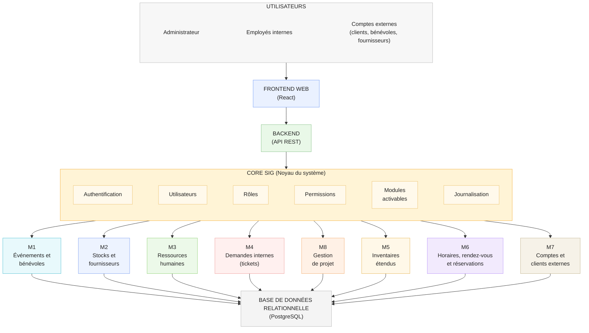
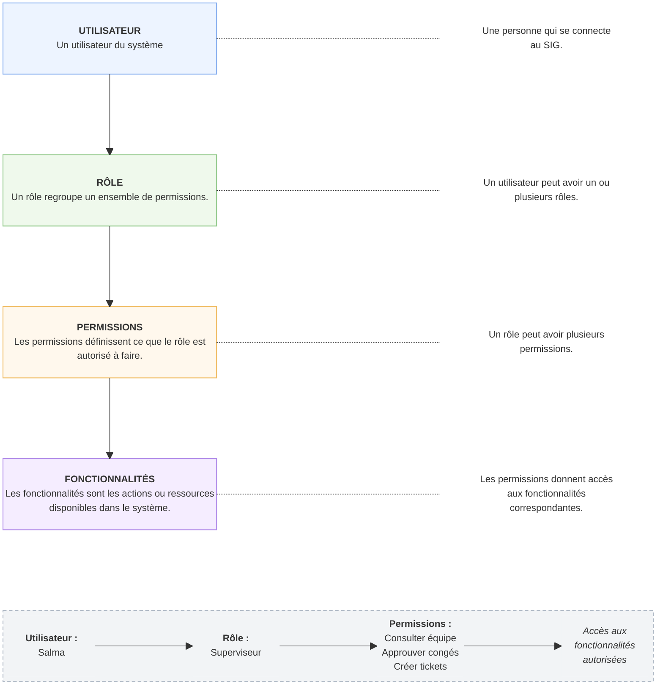
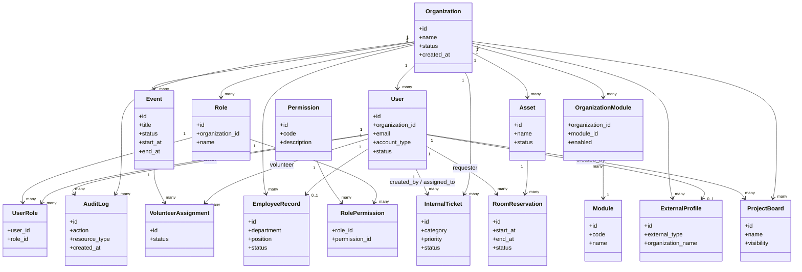
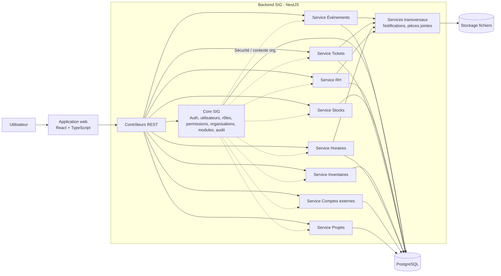
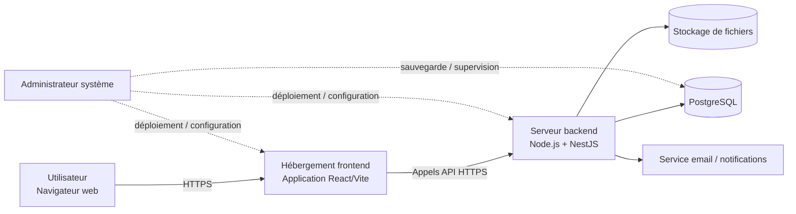
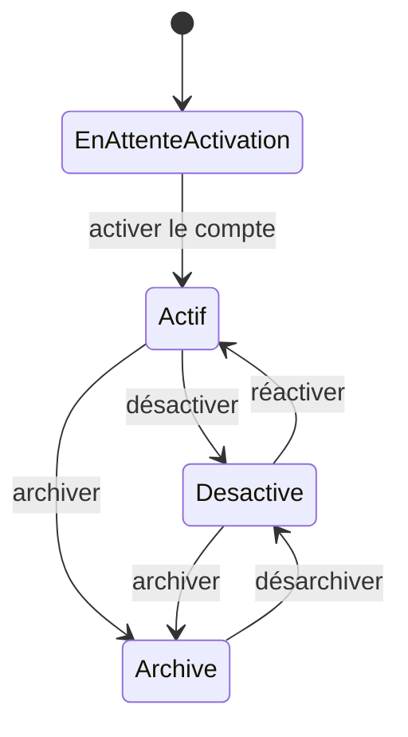
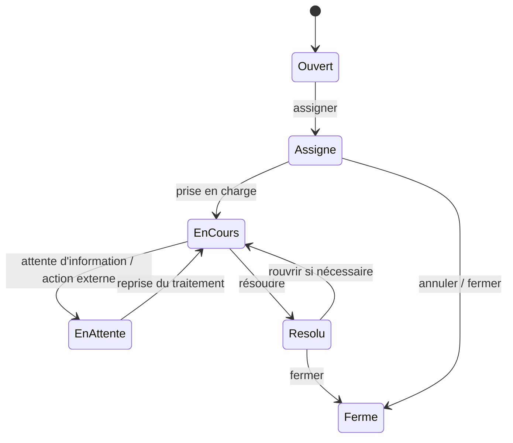
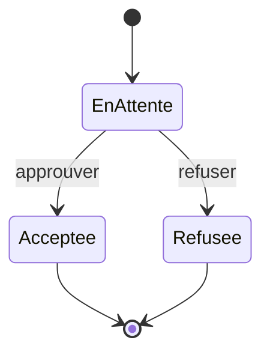
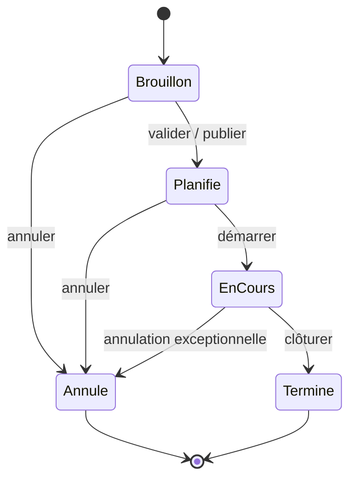

# Conception technique

[← Accueil du projet](../README.md) · [Documentation](../README.md#documentation)

## Sommaire

- [1. Introduction](#1-introduction)
- [2. Vue d'ensemble de l'architecture](#2-vue-densemble-de-larchitecture)
- [3. Architecture logique du SIG](#3-architecture-logique-du-sig)
- [4. Choix technologiques](#4-choix-technologiques)
- [5. Conception de la sécurité](#5-conception-de-la-sécurité)
- [6. Modèle de données](#6-modèle-de-données)
- [7. Schéma relationnel complet](#7-schéma-relationnel-complet)
- [8. UML de conception](#8-uml-de-conception)
- [9. Stratégie de développement](#9-stratégie-de-développement)
- [10. Conclusion](#10-conclusion)

---

&nbsp;
# 1. Introduction

## Objectif de la conception technique

La phase de conception technique a pour objectif de définir l'architecture logicielle du SIG (Système d'Information de Gestion) ainsi que les principaux choix technologiques qui guideront son développement.

Cette étape permet de transformer les besoins fonctionnels et les spécifications définis lors des phases précédentes en une solution technique cohérente, évolutive et maintenable. Elle sert également de référence pour l'implémentation du backend, du frontend, de la base de données et des interfaces API du système.

## Références

Le présent document s'appuie sur les livrables produits lors des phases précédentes du projet :

1.  [Projet SIG](00-projet-sig.md) :
    - Vision générale du produit.
    - Objectifs du projet.
    - Liste des modules supportés.
    - Orientation de l'architecture modulaire.

2.  [Analyse des besoins](01-analyse-des-besoins.md) :
    - Identification des utilisateurs.
    - Définition des rôles.
    - Description des modules du SIG.
    - Identification des dépendances entre modules.
    - Diagrammes de cas d'utilisation et diagramme de contexte.

3.  [Conception et spécifications fonctionnelles](02-conception-et-specifications-fonctionnelles.md) :
    - Règles fonctionnelles.
    - Scénarios d'utilisation.
    - Contraintes métier.
    - Diagrammes UML fonctionnels.

&nbsp;
# 2. Vue d'ensemble de l'architecture

## Principes

Le SIG est conçu autour de trois principes principaux : **la modularité** ; **la séparation des responsabilités** ; **le support de plusieurs organisations**. Ces principes permettent de construire un système flexible, facile à faire évoluer et adapté à différents types d'organisations.

## Modularité : 

La modularité est l'élément le plus important de l'architecture du SIG. Chaque module représente un domaine de gestion précis et peut être activé ou désactivé selon les besoins de l'organisation.

Une organisation peut donc utiliser uniquement les fonctionnalités qui lui sont utiles. Les modules qui seront développé lors de la première version sont :
- **Module 1** : Gestion des événements et bénévoles
- **Module 2** : Gestion des stocks et fournisseurs
- **Module 3** : Gestion RH
- **Module 4** : Gestion des demandes internes (tickets)
- **Module 5** : Gestion des inventaires étendus
- **Module 6** : Gestion des horaires, rendez-vous et réservations
- **Module 7** : Gestion des clients et comptes externes
- **Module 8** : Gestion de projet

Même si les modules sont indépendants, certains peuvent collaborer entre eux. Par exemple, un événement peut utiliser une salle provenant du module Inventaires ou créer des quarts de travail gérés par le module Horaires.

## Séparation des responsabilités : 

Le système est divisé en plusieurs couches ayant chacune une responsabilité précise :
- **Frontend** : Le frontend correspond à l'interface utilisée par les utilisateurs.  
  Il permet :
  - d'afficher les données ;
  - de saisir les informations ;
  - de naviguer entre les modules ;
  - d'offrir une expérience adaptée au rôle de l'utilisateur.
- **Backend** : Le backend contient la logique métier du système.  
  Il est responsable :
  - des règles d'affaires ;
  - de la validation des données ;
  - de la gestion des permissions ;
  - de l'exécution des opérations métier ;
  - des échanges avec la base de données.
- **Base de données** : La base de données est responsable du stockage des informations du SIG.  
  Elle permet :
  - de conserver les données des utilisateurs ;
  - de gérer les données des modules ;
  - d'assurer la cohérence des relations ;
  - de conserver les historiques et journaux du système.

Cette séparation permet de rendre le système plus facile à maintenir et à faire évoluer.

## Multi-organisation : 

Le SIG est conçu pour être utilisé par plusieurs organisations. Chaque organisation possède **ses propres utilisateurs**, **ses propres rôles**, **ses propres données** et **ses propres modules activés**.

L'administrateur peut activer ou désactiver des modules selon les besoins de son organisation. Lorsqu'un module est désactivé, **il n'apparaît plus dans l'interface**, **ses fonctionnalités deviennent inaccessibles** et **ses permissions ne sont plus utilisées**.

Cette approche permet d'offrir une solution adaptable à différents types d'organisations sans modifier l'application.

## Architecture globale du SIG

Le SIG est développé sous la forme d'une application web composée d'un **frontend**, d'une **API backend**, d'un **noyau central (Core SIG)** et d'une **base de données relationnelle**. Le noyau du système regroupe toutes les fonctionnalités communes :
- authentification ;
- gestion des utilisateurs ;
- gestion des rôles ;
- gestion des permissions ;
- gestion des organisations ;
- gestion des modules ;
- journalisation des actions.

Les modules métier utilisent ensuite ces services communs pour fournir leurs fonctionnalités spécifiques.

&nbsp;
# 3. Architecture logique du SIG

Le SIG est organisé autour d'un noyau central appelé Core SIG. Ce noyau regroupe les fonctionnalités communes utilisées par tous les modules du système. Les différents modules métier utilisent ensuite les services du Core SIG pour offrir leurs propres fonctionnalités.

Cette architecture permet :
- d'éviter la duplication de code ;
- de centraliser les règles communes ;
- de faciliter l'ajout de nouveaux modules ;
- de conserver une structure cohérente et évolutive.

## Noyau du système (Core SIG)

Le Core SIG est la base du système. Tous les modules en dépendent. Il est responsable de :
| **Service**      | **Description**                                           |
|------------------|-----------------------------------------------------------|
| Authentification | Validation des identifiants et connexion des utilisateurs |
| Utilisateurs     | Gestion des employés internes et comptes externes         |
| Rôles            | Attribution des rôles aux utilisateurs                    |
| Permissions      | Contrôle des accès aux fonctionnalités                    |
| Organisations    | Gestion des organisations utilisant le SIG                |
| Modules          | Activation et désactivation des modules                   |
| Journalisation   | Historique des actions importantes                        |

## Gestion des utilisateurs

Le système supporte deux grandes catégories d'utilisateurs :
1. Utilisateurs internes
    - Administrateur
    - Employé interne
    - Gestionnaire RH
    - Gestionnaire d'événements
    - Gestionnaire des stocks
    - Gestionnaire des inventaires
    - Gestionnaire des tickets
    - Gestionnaire des comptes externes
2. Utilisateurs externes
    - Client
    - Bénévole
    - Fournisseur

Chaque utilisateur possède un compte unique permettant l'accès aux fonctionnalités autorisées selon son rôle.

## Gestion des rôles et permissions

Le SIG utilise un système de contrôle d'accès basé sur les rôles *(Role-Based Access Control - RBAC)*.

Chaque utilisateur possède un ou plusieurs rôles. Les rôles regroupent un ensemble de permissions qui déterminent les fonctionnalités accessibles dans le système.

Le système fournit certains rôles de base comme **“Administrateur”**, **“Employé interne”** ou **“Compte externe”** mais chaque organisation peut ensuite créer ses propres rôles selon sa structure et ses besoins. Cette approche permet d'adapter le SIG à différents contextes organisationnels sans modifier le système.

**Exemples de rôles personnalisés :**
- Superviseur
- Coordonnateur
- Responsable des bénévoles
- Technicien TI

Les permissions sont associées aux fonctionnalités du système. Un rôle peut posséder plusieurs permissions et une même permission peut être utilisée par plusieurs rôles.

**Figure 1 - Modèle d'autorisation RBAC**

Cette approche permet à chaque organisation de définir sa propre structure de rôles et d'accès selon ses besoins.

## Gestion des modules activables

Le SIG repose sur une architecture modulaire permettant à chaque organisation d'activer ou de désactiver les modules de gestion selon ses besoins.

La gestion des modules est assurée par le Core SIG, qui centralise leur configuration et contrôle leur disponibilité pour chaque organisation.

## Fonctionnement général : 

Chaque module est identifié par un code unique et possède une configuration définissant notamment :
- Son nom et sa description.
- Son état d'activation pour l'organisation.
- Les permissions nécessaires pour accéder à ses fonctionnalités.
- Ses éventuelles interactions avec les autres modules.

Les modules sont activés ou désactivés par l'Administrateur de l'organisation, sous réserve des modules disponibles dans son abonnement.

## Activation et désactivation : 

Lorsqu'un module est activé :
- Il devient accessible aux utilisateurs disposant des permissions nécessaires.
- Ses fonctionnalités apparaissent dans les interfaces concernées.
- Ses interactions avec les autres modules actifs deviennent disponibles.

Lorsqu'un module est désactivé :
- Il disparaît des interfaces des utilisateurs.
- Ses fonctionnalités ne sont plus accessibles.
- Les permissions associées ne donnent plus accès à ses opérations.
- Les données déjà enregistrées sont conservées pour une éventuelle réactivation.
- La désactivation d'un module ne doit pas provoquer la suppression automatique de ses données.

## Gestion des dépendances : 

Certains modules peuvent interagir entre eux afin d'offrir des fonctionnalités supplémentaires.

**Par exemple :**
- Module 1 et Module 5 : association d'une salle ou d'un équipement à un événement.
- Module 1 et Module 6 : planification des quarts de bénévolat associés aux événements.
- Module 2 et Module 7 : gestion des profils de fournisseurs.
- Module 3 et Module 4 : création et suivi de tickets liés aux ressources humaines.
- Module 5 et Module 6 : réservation d'espaces et de salles disponibles.

Ces interactions sont conditionnelles. Si un module complémentaire est désactivé, les fonctionnalités propres aux autres modules doivent continuer de fonctionner lorsqu'elles ne dépendent pas de ce module.

## Contrôle et traçabilité : 

Le Core SIG vérifie l'état des modules et les permissions des utilisateurs avant d'autoriser une opération.

Chaque modification de configuration est enregistrée dans le journal d'audit du système, notamment l'organisation concernée, le module modifié, l'utilisateur responsable et la date de modification.

## Services métier

Les services métier constituent les composants responsables des fonctionnalités propres à chaque module du SIG.

Chaque service utilise les fonctionnalités communes du Core SIG, notamment l'authentification, les permissions, la gestion des utilisateurs et la journalisation.

## Module 1 - Gestion des événements et bénévoles : 
- Ce service assure la création et la gestion des événements, la définition des postes de bénévolat, l'affectation des bénévoles ainsi que la gestion des participants et de la billetterie.
- Il peut interagir avec les services d'inventaire, d'horaires et de comptes externes lorsque les modules correspondants sont activés.

## Module 2 - Gestion des stocks et fournisseurs : 
- Ce service est responsable du suivi des articles, des mouvements de stock, des quantités disponibles, des seuils minimums et des relations avec les fournisseurs.
- Il assure également la conservation de l'historique des mouvements et la génération des alertes de stock faible.

## Module 3 - Gestion RH : 
- Ce service centralise les dossiers des employés, les contrats, les statuts professionnels, les absences et les demandes de congé.
- Il applique les règles de validation des demandes et conserve l'historique des opérations RH.

## Module 4 - Gestion des demandes internes : 
- Ce service gère le cycle de vie des tickets, depuis leur création jusqu'à leur résolution ou fermeture.
- Il prend en charge leur catégorisation, leur assignation, leurs statuts, les commentaires et les pièces jointes.

## Module 5 - Gestion des inventaires étendus : 
- Ce service assure le suivi des actifs physiques de l'organisation, tels que les équipements, le mobilier et les salles.
- Il permet de gérer leur localisation, leur état, leur attribution et leur historique.

## Module 6 - Gestion des horaires, rendez-vous et réservations : 
- Ce service centralise les calendriers, les disponibilités, les rendez-vous et les réservations de salles.
- Il vérifie les conflits de réservation et gère les interactions avec les ressources et utilisateurs concernés.

## Module 7 - Gestion des clients et comptes externes : 
- Le Core SIG est responsable des comptes utilisateurs internes et externes : identité, authentification, statut du compte, rôles et permissions.
- Le module 7 est responsable des informations métier complémentaires des comptes externes : profils clients, bénévoles et fournisseurs, coordonnées, segmentation et historique des interactions.
- Les profils externes sont associés aux comptes du Core SIG sans duplication des données d'authentification.
- L'inscription publique des clients est disponible uniquement si le module 7 est activé et si l'organisation autorise cette fonctionnalité.
- Lorsqu'un module est désactivé, les comptes utilisateurs restent conservés dans le Core SIG. Les fonctionnalités et données métier du module désactivé deviennent inaccessibles, sans être supprimées.

## Module 8 - Gestion de projet : 
- Ce service permet l'organisation du travail individuel et collaboratif à travers des tableaux Kanban.
- Il assure la gestion des tableaux, des colonnes, des cartes, des affectations, des échéances et du suivi de l'avancement des tâches.

&nbsp;
# 4. Choix technologiques

Les choix technologiques doivent permettre de développer une application web modulaire, accessible depuis un navigateur, évolutive et utilisable par plusieurs organisations. Le SIG repose sur une séparation entre l'interface utilisateur, les services métier et le stockage des données.

Les technologies présentées ci-dessous constituent la base technique proposée pour la première version. Elles pourront évoluer au cours du développement sans remettre en cause les principes de l'architecture.

## Frontend

Le frontend du SIG sera développé avec React et TypeScript, en utilisant Vite pour l'environnement de développement et la génération de l'application.

Cette combinaison permettra de créer une interface composée de composants réutilisables, organisée autour de tableaux de bord, formulaires, tableaux de données et calendriers.

- **React** : création des composants d'interface et des vues propres aux différents modules.
- **TypeScript** : typage des données et amélioration de la maintenabilité du code.
- **Vite** : configuration du projet, développement local et génération des fichiers de production.
- **React Router** : navigation entre les pages et les modules autorisés.
- **Bibliothèque de composants** : composants communs pour les formulaires, tableaux, fenêtres et notifications.

L'interface sera responsive afin de rester accessible sur ordinateur, tablette et téléphone. Les modules non activés et les actions non autorisées seront masqués dans l'interface, sans que ce masquage remplace les contrôles de sécurité effectués par le backend.

## Backend

Le backend sera développé avec Node.js, TypeScript et NestJS. NestJS permettra d'organiser le système autour de services, de contrôleurs et de modules distincts.

Le backend prendra en charge les règles métier, la validation des entrées, la gestion des permissions, les interactions entre modules et l'accès à la base de données.

- **Core SIG** : authentification, utilisateurs, organisations, rôles, permissions, modules et journalisation.
- **Services métier** : un ensemble de services dédiés à chacun des huit modules de la première version.
- **API REST** : interface d'échange entre le frontend web et le backend.
- **Services transversaux** : gestion des pièces jointes, notifications et opérations communes.

Pour la première version, le backend restera une application modulaire unique plutôt qu'un ensemble de microservices. Cette organisation réduit la complexité du déploiement tout en conservant une séparation claire entre les domaines de gestion.

## Base de données

Le SIG utilisera PostgreSQL comme système de gestion de base de données relationnelle. Prisma ORM sera utilisé pour définir les modèles, les relations et les migrations du schéma.

Une base de données centralisée hébergera les données de plusieurs organisations. Les entités métier seront associées à leur organisation au moyen d'un identifiant, afin de garantir l'isolation logique des données.

- **Clés primaires** : identifiants uniques pour chaque enregistrement.
- **Clés étrangères** : relations contrôlées entre utilisateurs, organisations et objets métier.
- **Contraintes d'unicité** : prévention des doublons, notamment pour les courriels et certaines références métier.
- **Transactions** : mise à jour cohérente des opérations liées, comme un mouvement de stock ou une réservation.
- **Migrations** : suivi des évolutions du schéma sans modification manuelle des bases en production.

Les fichiers téléversés, tels que les contrats et pièces jointes, seront conservés dans un espace de stockage de fichiers sécurisé. La base de données ne conservera que leurs métadonnées et références.

## Authentification

L'authentification sera gérée par le backend. Les mots de passe seront conservés sous forme de hachages sécurisés, jamais en clair.

La première version pourra utiliser des jetons d'accès de courte durée et des jetons de renouvellement révocables. Pour le client web, ces jetons seront transportés au moyen de cookies sécurisés adaptés au contexte de déploiement, avec une protection contre les requêtes intersites.

À chaque opération protégée, le backend vérifiera l'identité de l'utilisateur, son organisation, les modules activés et les permissions nécessaires.

## Documentation API

L'API REST sera utilisée par l'application web. Elle permettra également, dans une évolution future, d'exposer des données du SIG à des outils externes afin de les consulter, de les exporter ou de les exploiter selon les besoins de l'organisation.

Cet accès externe devra être authentifié, limité aux données autorisées et contrôlé par les permissions. Il ne donnera pas un accès direct à la base de données.

La documentation technique des échanges pourra être générée à partir d'OpenAPI/Swagger. Le document « Documentation API REST » présent dans le dossier du projet servira de référence pour détailler progressivement les opérations proposées.

&nbsp;
# 5. Conception de la sécurité

La sécurité du SIG repose sur le principe selon lequel chaque utilisateur ne peut consulter ou modifier que les données auxquelles son rôle et son organisation lui donnent accès.

## Authentification

Un utilisateur doit disposer d'un compte actif pour accéder aux fonctionnalités protégées du SIG. L'authentification doit vérifier ses identifiants et l'état de son compte avant d'autoriser une session.

- Hachage sécurisé des mots de passe et contrôle des tentatives de connexion.
- Expiration et révocation des sessions ou jetons d'accès.
- Réinitialisation du mot de passe au moyen d'un mécanisme de vérification.
- Utilisation de HTTPS pour les échanges entre le navigateur et le serveur.
- Protection des cookies, vérification des entrées et prévention des attaques courantes.

## Autorisation

L'autorisation intervient après l'authentification. Elle consiste à vérifier si une opération précise est permise pour un utilisateur donné.

L'accès doit respecter simultanément quatre conditions : l'utilisateur est actif, il appartient à l'organisation concernée, le module demandé est activé et il possède la permission requise.

Le backend applique ces vérifications à chaque opération sensible. Un utilisateur ne doit pas pouvoir accéder aux données d'une autre organisation en modifiant simplement un identifiant dans une requête.

## Gestion des rôles

Les rôles sont définis pour chaque organisation et regroupent plusieurs permissions. Un utilisateur peut posséder plusieurs rôles si ses responsabilités le nécessitent.

Les rôles de base du système sont conservés, tandis que l'Administrateur peut créer des rôles personnalisés adaptés à sa structure. Les changements de rôle sont historisés.

## Gestion des permissions

Les permissions sont associées à des actions métier, par exemple consulter un événement, créer un ticket, attribuer un équipement ou approuver une demande de congé.

Le système applique le principe du moindre privilège : aucune opération n'est autorisée par défaut en l'absence d'une permission correspondante.

Une permission attribuée à un rôle ne peut pas rendre accessible une fonctionnalité appartenant à un module désactivé.

## Journalisation et audit

Le Core SIG conserve un historique des actions sensibles afin de faciliter le suivi administratif et la recherche d'incidents.

- Connexion et déconnexion, lorsque ces événements sont pertinents pour la sécurité.
- Création, désactivation et réactivation des comptes.
- Modification des rôles, permissions et modules activés.
- Opérations sensibles sur les dossiers RH, stocks, actifs, tickets et comptes externes.

Chaque entrée d'audit contiendra au minimum l'organisation, l'auteur de l'action, le type d'opération, la date, la ressource concernée et le résultat. Les secrets, mots de passe et jetons ne seront jamais enregistrés dans ces journaux.

&nbsp;
# 6. Modèle de données

Le modèle de données repose sur un ensemble d'entités centrales partagées par tous les modules, complété par des entités propres à chaque domaine de gestion.

## Entités centrales

- **User** : représente un compte utilisateur interne ou externe. Les informations principales comprennent son identifiant, son nom, son courriel, son type, son statut et son organisation.
- **Role** : représente un rôle défini pour une organisation. Il permet de regrouper les responsabilités des utilisateurs.
- **Permission** : représente une action autorisée sur une fonctionnalité précise du SIG.
- **Module** : représente une fonctionnalité métier activable ou désactivable pour une organisation.
- **Organization** : représente une organisation utilisant le SIG. Elle possède sa propre configuration, ses utilisateurs et ses données.
- **Des entités de liaison complètent ce noyau** : UserRole, RolePermission et OrganizationModule. Elles permettent de gérer les relations multiples sans dupliquer les informations.

## Relations principales

- Une organisation possède plusieurs utilisateurs, rôles et éléments de gestion.
- Un utilisateur appartient à une organisation et peut posséder plusieurs rôles.
- Un rôle peut être attribué à plusieurs utilisateurs et posséder plusieurs permissions.
- Un module peut être proposé à plusieurs organisations, mais son activation est enregistrée séparément pour chacune.
- Les ressources métier sont reliées à leur organisation et aux utilisateurs concernés.

Les relations entre entités utilisent des identifiants stables, et non des noms ou des courriels susceptibles de changer.

## Dépendances entre modules

Les modules utilisent les entités centrales du Core SIG pour identifier les utilisateurs, appliquer les permissions et retrouver l'organisation concernée.

Les données spécifiques restent gérées par leurs services métier. Lorsqu'un module dépend d'un autre, la relation s'effectue à travers des identifiants et des services explicitement définis.

Par exemple, une réservation associe un utilisateur, un créneau horaire et une salle enregistrée dans l'inventaire étendu. Une affectation de bénévole associe un compte externe, un événement et éventuellement un quart de travail.

## Principes de conception de la base de données

- Chaque table métier doit pouvoir être rattachée sans ambiguïté à une organisation.
- Les relations utilisent des clés étrangères et des règles de cohérence adaptées aux données.
- Les courriels et références nécessitant l'unicité sont contrôlés au niveau de la base de données.
- Les données sensibles sont limitées aux acteurs autorisés, notamment pour les dossiers RH.
- Les comptes utilisateurs sont désactivés ou archivés plutôt que supprimés.
- Les suppressions métier tiennent compte des historiques, des dépendances et des obligations de conservation.
- Les sauvegardes, les migrations et la restauration doivent être prévues avant la mise en production.

&nbsp;
# 7. Schéma relationnel complet

Le schéma ci-dessous présente les principales tables prévues pour la première version. Les noms techniques et les attributs pourront être précisés lors de l'implémentation des modèles Prisma.

## Tables du Core SIG

- `Organization (id, name, status, created_at)` : organisation utilisant le SIG.
- `User (id, organization_id, email, password_hash, first_name, last_name, account_type, status, created_at)` : compte utilisateur.
- `Role (id, organization_id, name, description)` : rôle disponible dans une organisation.
- `Permission (id, code, description, module_id)` : permission associée à une action.
- `UserRole (user_id, role_id)` : association entre les utilisateurs et leurs rôles.
- `RolePermission (role_id, permission_id)` : association entre les rôles et les permissions.
- `Module (id, code, name, description)` : définition globale d'un module.
- `OrganizationModule (organization_id, module_id, enabled, enabled_at)` : état d'activation d'un module.
- `AuditLog (id, organization_id, actor_user_id, action, resource_type, resource_id, result, created_at)` : historique des actions sensibles.
- `Attachment (id, organization_id, owner_type, owner_id, storage_key, file_name, mime_type, created_at)` : métadonnées des fichiers téléversés.

Les clés étrangères vers Organization et User permettent de rattacher les éléments transversaux à leur organisation.

Pour la V1, chaque compte User appartient à une seule organisation. Le couple (organization_id, email) doit être unique : un même courriel peut donc être utilisé dans plusieurs organisations, mais pas plusieurs fois dans la même organisation.

Les associations UserRole, RolePermission et OrganizationModule possèdent des contraintes d'unicité sur leurs clés composées.

Les règles de connexion devront identifier l'organisation concernée afin de retrouver le bon compte utilisateur.

## Tables des modules métier

### Module 1 :
- `Event (id, organization_id, title, start_at, end_at, location, status)`
- `VolunteerPosition (id, event_id, name, required_count)`
- `VolunteerAssignment (id, event_id, volunteer_user_id, position_id, status)`
- `TicketType (id, event_id, name, price, capacity)`
- `EventTicket (id, event_id, ticket_type_id, customer_user_id, status)`

### Module 2 :
- `StockItem (id, organization_id, name, quantity, unit, minimum_threshold, location)`
- `StockMovement (id, stock_item_id, quantity, movement_type, reason, created_at)`
- `SupplierItem (supplier_user_id, stock_item_id)`

### Module 3 :
- `EmployeeRecord (id, organization_id, user_id, department, position, status)`
- `EmploymentContract (id, employee_record_id, contract_type, start_at, end_at, attachment_id)`
- `LeaveRequest (id, employee_record_id, start_at, end_at, leave_type, status, reviewed_by)`
- `HRHistory (id, employee_record_id, action, created_at)`

### Module 4 :
- `InternalTicket (id, organization_id, created_by, assigned_to, category, priority, status, description)`
- `TicketComment (id, ticket_id, author_id, content, created_at)`
- `TicketHistory (id, ticket_id, action, actor_id, created_at)`

### Module 5 :
- `Asset (id, organization_id, category_id, name, status, location_id, assigned_user_id)`
- `AssetCategory (id, organization_id, name)`
- `AssetLocation (id, organization_id, building, room)`
- `AssetHistory (id, asset_id, action, actor_id, created_at)`

### Module 6 :
- `CalendarEntry (id, organization_id, owner_user_id, start_at, end_at, type)`
- `Appointment (id, calendar_entry_id, title, description)`
- `AppointmentParticipant (appointment_id, user_id, response_status)`
- `RoomReservation (id, organization_id, asset_id, requester_user_id, start_at, end_at, status)`

### Module 7 :
- `ExternalProfile (id, organization_id, user_id, external_type, organization_name, phone)`
- `ClientTag (id, organization_id, name)`
- `ExternalProfileTag (external_profile_id, tag_id)`
- `ExternalInteraction (id, external_profile_id, interaction_type, created_at)`

### Module 8 :
- `ProjectBoard (id, organization_id, name, visibility, created_by)`
- `ProjectColumn (id, board_id, name, position)`
- `ProjectCard (id, column_id, title, description, due_at, position, status)`
- `CardAssignment (card_id, user_id)`
- `CardComment (id, card_id, author_id, content, created_at)`

Les pièces jointes peuvent être associées aux objets autorisés à travers le service transversal de fichiers. Les mécanismes de suppression ou d'archivage doivent préserver les relations et les historiques nécessaires.

## Module 1 ↔ Module 5

Un événement peut être associé à une salle ou à une ressource enregistrée dans le module Inventaires étendus. La relation est facultative et n'est accessible que si les deux modules sont activés.

Une table EventAsset (event_id, asset_id, usage_type) pourra conserver cette association. Le service de gestion d'événements vérifiera la disponibilité de l'actif avant sa réservation éventuelle.

## Module 1 ↔ Module 6

Les quarts de travail des bénévoles peuvent être associés à un événement. Une table EventShift (id, organization_id, event_id, start_at, end_at, position_id) définit les quarts, et une table ShiftAssignment (shift_id, volunteer_user_id, status) associe les bénévoles.

Ces informations sont proposées uniquement lorsque les modules Événements et Horaires sont activés.

## Module 1 ↔ Module 7

Les bénévoles et les clients sont représentés par des comptes externes gérés dans le Core SIG et, pour leurs informations complémentaires, dans le module 7.

Les affectations de bénévoles et les billets permettent de relier ces comptes aux événements sans dupliquer leur identité.

## Module 2 ↔ Module 7

Les fournisseurs possèdent un compte externe de type fournisseur. La relation SupplierItem permet de relier un fournisseur à plusieurs articles et un article à plusieurs fournisseurs.

Le module Stocks gère les articles et les mouvements. Le module Comptes externes conserve les informations générales du fournisseur.

## Module 3 ↔ Module 4

Un ticket interne peut être associé à une question RH lorsque les modules correspondants sont activés. Le ticket conserve son responsable et son statut, tandis que le service RH reste responsable des données confidentielles du dossier employé.

Le lien éventuel vers un dossier RH doit être soumis à une vérification de permission supplémentaire.

## Flux transversaux du Core SIG

Toutes les opérations suivent le même chemin de contrôle : identification de l'organisation, authentification, vérification de l'activation du module, vérification des permissions, exécution du service métier puis journalisation de l'action si nécessaire.

Les relations entre tables appartenant à des domaines différents doivent être contrôlées afin qu'aucune référence ne puisse relier deux organisations distinctes.

&nbsp;
# 8. UML de conception

Les diagrammes suivants représentent les principales structures du système et leurs interactions. Ils constituent des modèles de conception destinés à guider le développement ; les détails d'implémentation pourront être affinés ultérieurement.

## Diagramme de classes global

Le diagramme de classes présente les entités centrales et les principales entités métier. Il illustre le rattachement des utilisateurs aux organisations, la gestion des rôles et des permissions ainsi que les relations avec les modules de gestion.

**Figure 2 - Diagramme de classes global du SIG**

## Diagramme de composants

Le diagramme de composants représente la séparation entre l'application web, l'API REST, le Core SIG, les modules métier, la base de données et les services transversaux.

**Figure 3 - Diagramme de composants du SIG**

## Diagramme de déploiement

Le diagramme de déploiement présente une configuration de production possible avec un navigateur web, un hébergement frontend, un serveur backend, une base de données et un espace de stockage pour les fichiers.

**Figure 4 - Diagramme de déploiement du SIG**

## Diagramme d'états

Les diagrammes d'états définissent les transitions principales des objets métier dont le statut évolue au cours de leur utilisation.

Compte utilisateur : les comptes peuvent être en attente d'activation, actifs, désactivés ou archivés. La réactivation et le désarchivage sont prévus selon les règles définies dans les spécifications fonctionnelles.

**Figure 5 - Diagramme d'états d'un compte utilisateur**

Ticket : le cycle principal prévoit les états Ouvert, Assigné, En cours, En attente, Résolu et Fermé. Les changements de statut sont enregistrés dans l'historique du ticket.

**Figure 6 - Diagramme d'états d'un ticket**

Demande de congé : une demande soumise est placée En attente, puis Acceptée ou Refusée par le gestionnaire RH. Le planning est actualisé lorsqu'elle est acceptée.

**Figure 7 - Diagramme d'états d'une demande de congé**

Événement : un événement peut être enregistré comme Brouillon, passer à Planifié, être En cours, puis Terminé. Une annulation reste possible selon son état et les règles métier.

**Figure 8 - Diagramme d'états d'un événement**

&nbsp;
# 9. Stratégie de développement

Le développement sera organisé progressivement afin de rendre le SIG utilisable dès les premières étapes, tout en limitant les risques liés aux dépendances entre modules.

## Ordre de réalisation des modules

Le Core SIG sera développé en premier. Il fournira l'authentification, les organisations, les utilisateurs, les rôles, les permissions et la configuration des modules.

Les modules seront ensuite intégrés par groupes cohérents afin que les fonctionnalités fondamentales soient opérationnelles avant les interactions plus complexes.

- **Phase 1** : Core SIG et mise en place de l'application web.
- **Phase 2** : Module 7 (comptes externes) et Module 4 (tickets).
- **Phase 3** : Module 8 (gestion de projet) et Module 1 (événements et bénévoles).
- **Phase 4** : Module 2 (stocks et fournisseurs) et Module 5 (inventaires étendus).
- **Phase 5** : Module 6 (horaires et réservations) et Module 3 (gestion RH).

Cet ordre est une proposition d'implémentation. Il pourra être ajusté selon les contraintes de développement et les besoins prioritaires retenus pour les premières démonstrations.

## Découpage en sprints

Le travail pourra être divisé en sprints de courte durée, chacun aboutissant à une fonctionnalité vérifiable et à une mise à jour de la documentation.

- **Sprint de préparation** : structure du dépôt, environnement local, base de données et configuration des outils.
- **Sprint Core SIG** : connexion, comptes, organisations, rôles, permissions et modules activables.
- **Sprints métier** : implémentation progressive des fonctionnalités de chaque module, avec validations et contrôles d'accès.
- **Sprints d'intégration** : gestion des dépendances entre modules, tests des parcours transversaux et correction des incohérences.
- **Sprint de finalisation** : amélioration de l'ergonomie, tests, documentation et préparation de la démonstration.

Les tests unitaires ciblés, les tests d'intégration des services critiques et les scénarios manuels seront réalisés au fur et à mesure du développement, plutôt qu'uniquement à la fin.

## Évolution future du SIG

L'architecture doit permettre d'ajouter de nouveaux modules sans modifier profondément le Core SIG. Les modules de gestion financière, de communication, de formation et de conformité pourront être intégrés dans des versions ultérieures.

Une évolution de l'API REST pourra également permettre à des applications externes autorisées d'accéder à certaines données, de produire des rapports ou de réaliser des exports contrôlés.

Des optimisations pourront être ajoutées selon l'utilisation réelle du produit : performances, surveillance, automatisation des tests, gestion avancée des abonnements et déploiement à plus grande échelle.

&nbsp;
# 10. Conclusion

Cette phase de conception technique définit l'architecture générale du SIG, les technologies proposées, les mécanismes de sécurité et les principales structures de données nécessaires au développement de la première version.

L'organisation autour d'un Core SIG et de modules métier distincts permettra d'offrir un logiciel web personnalisable, adapté aux rôles des utilisateurs et aux besoins de chaque organisation.

Les schémas relationnels et les diagrammes UML constituent une base pour la mise en œuvre des composants techniques. La prochaine étape portera sur le design UX/UI et la définition des interfaces qui seront utilisées au quotidien par les différentes catégories d'utilisateurs.
